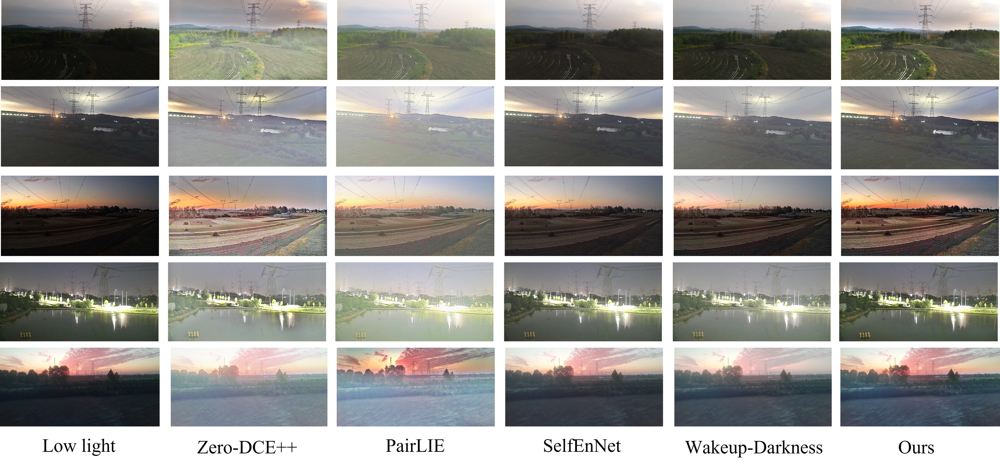

# MicroDiffusion

Minimal training and inference code for MicroDiffusion, developed from the authors' LightenDiffusion-based research code.


## Qualitative comparison

The manuscript comparison figure is included with the timestamp and camera overlay strips cropped from each image row.



## Requirements

- Python 3.10 or newer
- PyTorch and the packages in `requirements.txt`
- The official [LightenDiffusion repository](https://github.com/JianghaiSCU/LightenDiffusion), placed beside this project as `LightenDiffusion-main`. Its `models/unet.py` is loaded at runtime.
- Training and validation image pairs, kept locally under `data/`

The dataset and model checkpoints are not included. The transmission-line monitoring dataset is available from the authors upon reasonable request. Each non-comment line in `datasets/train_pairs.txt` and `datasets/validation_pairs.txt` contains two paths separated by a tab (recommended) or whitespace: the low-light image followed by its corresponding normal-light image. Paths are relative to `data/` unless absolute paths are supplied. The images form same-scene weak pairs; pixel alignment is not required. Paired images and all images within a training batch must have the same dimensions. Training preserves the full images for illumination and noise statistics, and crops only the synthetic denoising task inside the model.

## Train

Edit `configs/default.yml` for the data root and training settings, then run:

```bash
python train.py
```

Training starts from the model's standard initialization. To initialize compatible layers from the authors' earlier development checkpoint, add `--initialize-from /path/to/model_latest.pth.tar`. To continue a run, use `--resume checkpoints/model_latest.pth.tar`. Checkpoints and validation outputs are written to `checkpoints/` and `outputs/`.

## Test

```bash
python test.py --checkpoint checkpoints/model_latest.pth.tar --input path/to/low_light.png --output enhanced.png
```

Training requires paired images; inference uses only the low-light input image. Data, checkpoints, and generated outputs are excluded from Git.
