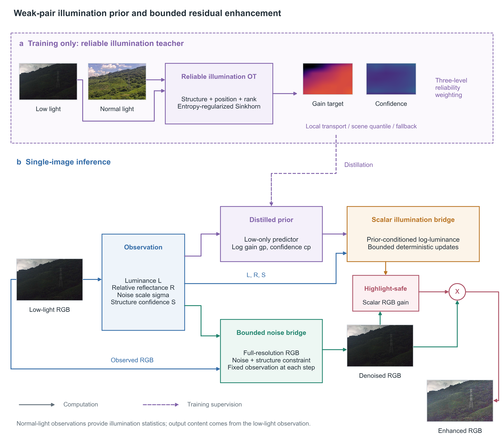

# MicroDiffusion

Code of Weakly Paired Illumination Prior-Guided Low-Light Enhancement of Transmission-Line Monitoring Images.



## Qualitative comparison


## Train

Edit `configs/default.yml` for the data root and training settings, then run:

```bash
python train.py
```

## Test

```bash
python test.py --checkpoint checkpoints/model_latest.pth.tar --input path/to/low_light.png --output enhanced.png
```

